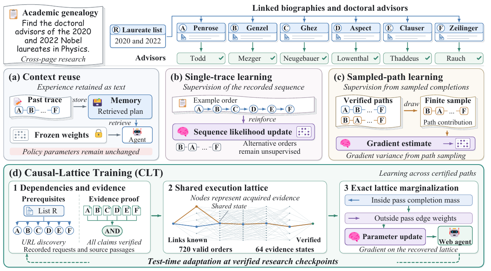

# Learning Beyond a Single Trace: Causal Execution Lattices for Test-Time Training of Web Agents

Long-horizon Web agents conduct extended research with intermittent verification
feedback. Existing test-time training (TTT) methods adapt large language models
from execution experience, yet a single trajectory can reinforce incidental
research decisions. To address this challenge, we propose Causal-Lattice
Training (CLT), which recovers a certified execution space from one verified Web
trace. Specifically, CLT combines action dependencies with source-aware evidence
proofs to represent alternative orders, evidence combinations, and valid
completion paths. We maximize the aggregate cost-weighted mass of certified
completions and derive an exact dynamic-programming solution for this mass and
its gradient. We further characterize conditions for sound path recovery and
state compression, providing a theoretical perspective on the algorithm design.
We evaluate CLT with three backbones on five Web research benchmarks covering
navigation, multi-document reasoning, and report generation. CLT leads all
benchmark metrics, with 3.2–5.3-point gains in answer quality and citation
accuracy over the strongest baselines. Under matched test-time updates, CLT
raises subsequent verification by up to 9.4 points over the frozen policy and
reduces reference-policy KL by 64.6–66.0 percent relative to single-trace
training. Code is available at <https://anonymous.4open.science/r/CLT-CEC5/>.

<p align="center">
  
</p>

## Installation

Use Python 3.10 or later and a PyTorch build appropriate for the execution
hardware.

```bash
python -m venv .venv
source .venv/bin/activate
python -m pip install -e '.[models,test]' \
  --index-url https://pypi.tuna.tsinghua.edu.cn/simple
export HF_ENDPOINT=https://hf-mirror.com
```

## Quick start

This CPU software fixture exercises discovery, source attribution,
first-completion compilation, and exact marginalization.

```bash
python examples/capture_trace.py --output outputs/fixture/trace.json

clt compile --trace outputs/fixture/trace.json --goal start_year \
  --verifier literal-fixture --output outputs/fixture/compiled

clt inspect --graph outputs/fixture/compiled/lattice.json \
  --fixture-probability 0.1 --output outputs/fixture/marginals.json
```

The fixture requires two independent origins. A republication shares its primary
source's origin. Research traces use the NLI verifier.

## Research traces

Capture exact requests, responses, latency, discovered resources, document
spans, and snapshot metadata with `TraceRecorder`. Declare each requirement
before its supporting actions.

```python
from clt.records import TraceRecorder

recorder = TraceRecorder(
    task_id="research_task", question=question, snapshot_id=snapshot_id,
    tools=tool_schemas, initial_resources=known_urls,
)
recorder.declare("requirement", requirement_text, declared_proof)
```

The variables are supplied by the task environment. Record observations and save
`recorder.to_dict()` in the [trace format](docs/trace-format.md). Acquired
passages provide verification candidates; reference answers and final evaluator
feedback supply independent evaluation.

## Test-time training

Select a backbone configuration and pin `model.revision` and
`verifier.revision`. Gated checkpoints require provider access. The default
verifier is DeBERTa-v3-large with entailment threshold 0.65.

```bash
clt adapt --trace inputs/research_trace.json --goal requirement \
  --config configs/qwen3-8b.yaml --output outputs/task
```

`inputs/research_trace.json` is a prepared research trace. Adaptation certifies
observations, compiles the lattice, recomputes posterior path weights, and saves
the adapter and optimizer. `--uncompressed` selects the original
first-completion DAG.

Resume an interrupted update or continue with a later declared requirement.

```bash
clt adapt --trace inputs/research_trace.json --goal requirement \
  --config configs/qwen3-8b.yaml --resume outputs/task --output outputs/task

clt continue --trace inputs/research_trace.json --goal requirement \
  --config configs/qwen3-8b.yaml --checkpoint outputs/task
```

`OnlineAgent` connects adaptation to a tool executor.
[online_adaptation.py](examples/online_adaptation.py) runs model-selected
actions against a captured snapshot. Independent tasks restore the entering
policy with `LatticeTrainer.start_task`.

## Configuration

| Setting | Value |
| --- | --- |
| Backbones | Qwen3-8B, Llama-3.1-8B-Instruct, Gemma-3-4B-it |
| LoRA | Rank 16, scale 32 |
| Optimizer | AdamW, learning rate 1e-5, gradient clipping 1.0 |
| Checkpoint update | 2 steps, reference-to-current KL coefficient 0.05 |
| Action-cost coefficient | 0.02, recorded latency in seconds |
| Task budget | 40 interactions, 8 checkpoints |
| Inference | BF16, context 32768, scoring batch size 4 |
| Evaluation seeds | 17, 29, 43, 61, 83 |

[configs/](configs) contains the model profiles. The [implementation
reference](docs/trace-format.md#policy-scoring-and-updates) specifies token
scoring, context limits, and regularization weights.

## Evaluation

Score completed answers with each benchmark's native protocol.

| Benchmark | Official resource | Metric |
| --- | --- | --- |
| WebWalkerQA | [Dataset](https://huggingface.co/datasets/callanwu/WebWalkerQA) | Question-answer scoring |
| FRAMES | [Dataset](https://huggingface.co/datasets/google/frames-benchmark) | Factual answer scoring |
| FanOutQA | [Submission protocol](https://github.com/zhudotexe/fanoutqa) | Open-book loose accuracy, blind test |
| DeepResearchBench | [Evaluator](https://github.com/Ayanami0730/deep_research_bench) | RACE and FACT |
| ScholarQA-CS2 | [AstaBench](https://github.com/allenai/asta-bench) | Global report metric |

Aggregate revision-matched native scores in their original units.

```bash
clt summarize --scores inputs/native_scores.jsonl --output outputs/summary.json
```

Each JSONL record contains `data_kind: benchmark_result`, benchmark, split,
metric, seed, value, and dataset/model/evaluator revisions. The summary reports
the mean and sample standard deviation.

## Software checks

```bash
CUDA_VISIBLE_DEVICES='' python -m pytest -q
```

CPU checks cover certificates, exact mass and gradients, compression, policy
scoring, and interrupted updates.

## License

[MIT License](LICENSE).
