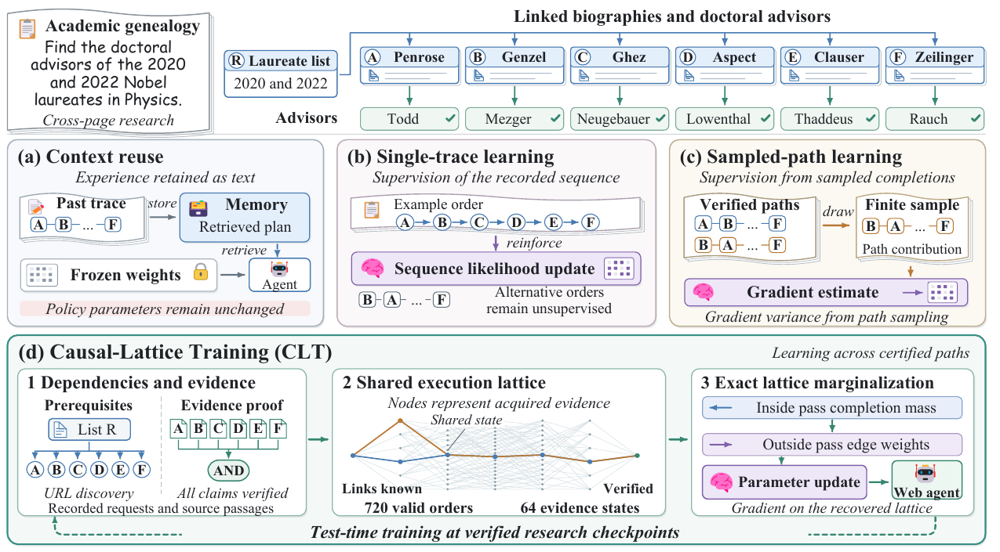
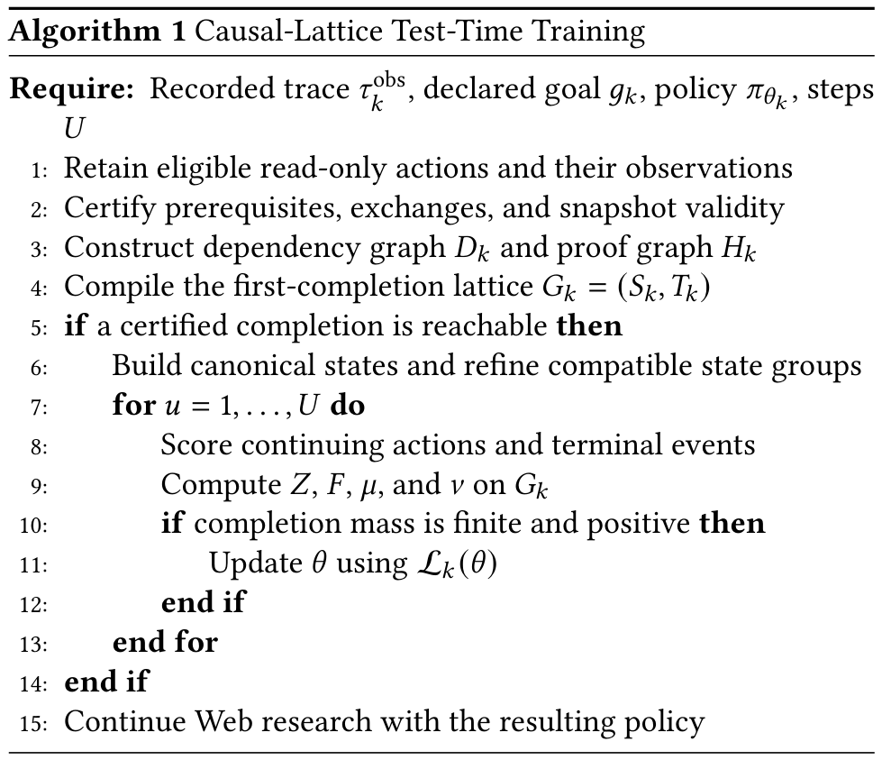
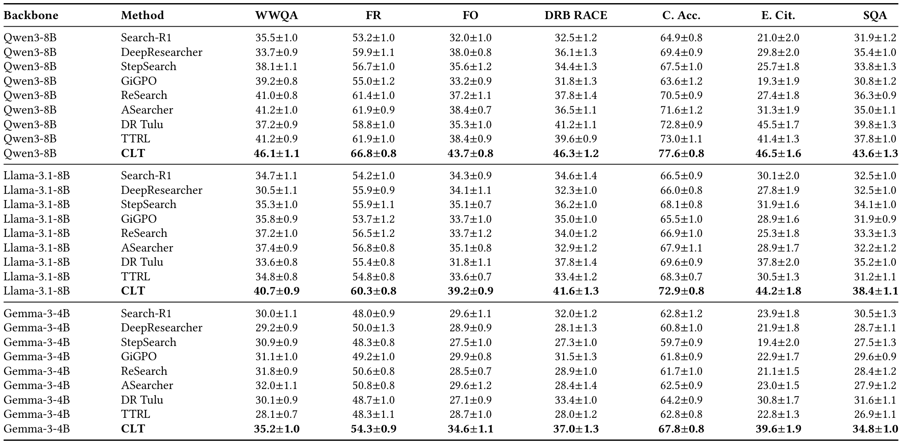

# Learning Beyond a Single Trace: Causal Execution Lattices for Test-Time Training of Web Agents

Long-horizon Web agents conduct extended research with intermittent verification
feedback. Existing test-time training (TTT) methods adapt large language models
from execution experience, yet a single trajectory can reinforce incidental
research decisions. To address this challenge, we propose Causal-Lattice
Training (CLT), which recovers a certified execution space from one verified Web
trace. Specifically, CLT combines action dependencies with source-aware evidence
proofs to represent alternative orders, evidence combinations, and valid
completion paths. We maximize the aggregate cost-weighted mass of certified
completions and derive an exact dynamic-programming solution for this mass and
its gradient. We further characterize conditions for sound path recovery and
state compression, providing a theoretical perspective on the algorithm design.
We evaluate CLT with three backbones on five Web research benchmarks covering
navigation, multi-document reasoning, and report generation. CLT leads all
benchmark metrics, with 3.2–5.3-point gains in answer quality and citation
accuracy over the strongest baselines. Under matched test-time updates, CLT
raises subsequent verification by up to 9.4 points over the frozen policy and
reduces reference-policy KL by 64.6–66.0 percent relative to single-trace
training.

## Algorithm Flow

<p align="center">
  
</p>

**Figure 1.** Adaptation from a Web research execution. The illustrated task traces doctoral-advisor relationships through linked biographies. After link discovery, six independent reads needed for verification admit 720 orders over 64 acquired-evidence states. Context reuse, single-trace supervision, and path sampling use different portions of this experience. CLT shares partial evidence states and computes the aggregate training contribution exactly within the constructed execution lattice.

To construct a reliable training signal from one Web research execution, CLT first
certifies action dependencies and evidence requirements using recorded interactions. It
then compiles the certified alternatives into a shared-state execution lattice. Finally,
an exact graph computation supplies the completion mass and its gradient for test-time
updates.

1. **Verified Execution Graph Framework.** For each recorded action, the compiler
   retains its exact tool name, arguments, response, discovered links, content digest,
   and snapshot identifier. It first adds prerequisites when a request uses a URL,
   argument, or permission acquired through an earlier action. It preserves
   the observed precedence for pairs with unresolved certificates. AND nodes represent
   jointly required facts, OR nodes represent alternative supporting passages, and
   distinct-origin constraints implement requirements for independent sources.

2. **Proof-Constrained Lattice Design.** This graph shares partial states reached through
   certified alternative orders and applies the evidence proof condition at every state.
   A conservative backward partition refinement compares terminal behavior, canonical
   contexts, action strings, action costs, and successor groups. It retains the
   multiplicity of transitions entering each group, ensuring that their mass
   contributions are accumulated correctly.

3. **Causal-Lattice Training Algorithm.** Thus, the dynamic program evaluates the
   completion mass and gradient of the entire certified completion space exactly for
   the current policy and compiled graph. Posterior path weights are detached within
   each step and recomputed after the parameters change. If verification yields no certified
   completion, or the completion mass is numerically unavailable, CLT keeps the current
   policy and continues research. Independent evaluation tasks restore their declared
   initial checkpoint.



## Results

### Main Results

**Table 1.** Performance on five public benchmarks and three backbones. WWQA, FR, and FO report answer scores, with FO denoting the FanOutQA blind test; DRB reports RACE, citation accuracy (C. Acc.), and effective citations (E. Cit.); SQA reports the global score. Entries report five-seed means; ± denotes sample standard deviation. Bold marks the best score per backbone.



**CLT improves answer quality across model families and retrieval requirements.** On WWQA, it leads the strongest external method by 4.9, 3.3, and 3.2 points for Qwen, Llama, and Gemma. The corresponding FRAMES gains are 4.9, 3.5, and 3.5 points. FanOutQA gains are 5.3, 4.1, and 4.7 points under the official blind evaluation. Crediting certified alternatives supports both navigation and evidence gathering.

**The gains extend to report quality and citation accuracy.** CLT improves RACE by 5.1, 3.8, and 3.6 points and ScholarQA-CS2 by 3.8, 3.2, and 3.2 points over the strongest external results. Citation-accuracy gains are 4.6, 3.3, and 3.6 points. Source-aware proofs align completion supervision with supporting passages and their origins.

## Getting Started

### Environment Setup

```bash
conda env create -f environment.yml
conda activate clt
pip install -e '.[models]'
```

### Data Preparation

The experiments use [WebWalkerQA](https://huggingface.co/datasets/callanwu/WebWalkerQA),
[FRAMES](https://huggingface.co/datasets/google/frames-benchmark),
[FanOutQA](https://github.com/zhudotexe/fanoutqa),
[DeepResearchBench](https://github.com/Ayanami0730/deep_research_bench), and
[ScholarQA-CS2](https://github.com/allenai/asta-bench).

CLT takes a recorded research trace containing the task question, tool requests
and observations, source documents, and declared verification requirements.
The command below reads `inputs/research_trace.json` and uses `requirement`
as the requirement identifier. The [input format](docs/trace-format.md#captured-observations)
specifies the trace fields.

## Training

Select a backbone:

- **Qwen3-8B**: `MODEL=qwen3-8b`
- **Llama-3.1-8B-Instruct**: `MODEL=llama3.1-8b`
- **Gemma-3-4B-it**: `MODEL=gemma3-4b`

Run CLT with the selected backbone:

```bash
python -m clt adapt --trace inputs/research_trace.json --goal requirement \
  --config "configs/${MODEL}.yaml" --output "outputs/${MODEL}"
```

To resume an interrupted checkpoint update, add `--resume "outputs/${MODEL}"`
to the same training command.

## Usage

Continue research with the selected backbone and updated policy, using the current
trace and the next declared requirement in the same task. The command emits the
next tool request for execution by the research environment:

```bash
python -m clt continue --trace inputs/current_trace.json --goal next_requirement \
  --config "configs/${MODEL}.yaml" --checkpoint "outputs/${MODEL}"
```

## Evaluation

Evaluate completed answers with each benchmark’s official evaluator.
Save the scores in `inputs/native_scores.jsonl` using the
[score record format](docs/trace-format.md#evaluation), then aggregate the runs:

```bash
python -m clt summarize --scores inputs/native_scores.jsonl --output outputs/summary.json
```

## License

[MIT License](LICENSE).
