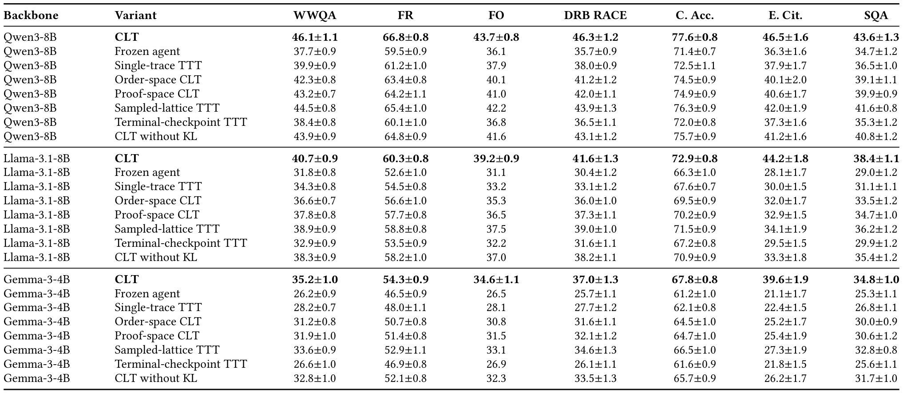
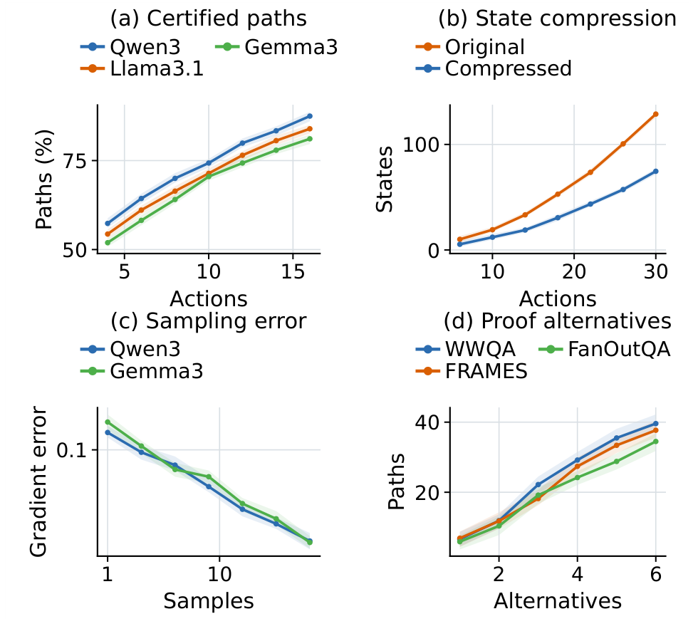

# Learning Beyond a Single Trace: Causal Execution Lattices for Test-Time Training of Web Agents

Long-horizon Web agents conduct extended research with intermittent verification
feedback. Existing test-time training (TTT) methods adapt large language models
from execution experience, yet a single trajectory can reinforce incidental
research decisions. To address this challenge, we propose Causal-Lattice
Training (CLT), which recovers a certified execution space from one verified Web
trace. Specifically, CLT combines action dependencies with source-aware evidence
proofs to represent alternative orders, evidence combinations, and valid
completion paths. We maximize the aggregate cost-weighted mass of certified
completions and derive an exact dynamic-programming solution for this mass and
its gradient. We further characterize conditions for sound path recovery and
state compression, providing a theoretical perspective on the algorithm design.
We evaluate CLT with three backbones on five Web research benchmarks covering
navigation, multi-document reasoning, and report generation. CLT leads all
benchmark metrics, with 3.2–5.3-point gains in answer quality and citation
accuracy over the strongest baselines. Under matched test-time updates, CLT
raises subsequent verification by up to 9.4 points over the frozen policy and
reduces reference-policy KL by 64.6–66.0 percent relative to single-trace
training.

## Algorithm Flow

To construct a reliable training signal from one Web research execution, CLT first certifies action dependencies and evidence requirements using recorded interactions.

1. Retain eligible read-only actions and their observations. Certify prerequisites, exchanges, and snapshot validity.
2. Construct the dependency graph and proof graph. Compile the first-completion lattice.
3. If a certified completion is reachable, build canonical states and refine compatible state groups. At each update, score continuing actions and terminal events, then compute completion mass, forward prefix mass, and edge and terminal posterior probabilities.
4. If completion mass is finite and positive, update the policy using the CLT objective.
5. Continue Web research with the resulting policy.

<p align="center">
  
</p>

**Figure 1.** Adaptation from a Web research execution. The illustrated task traces doctoral-advisor relationships through linked biographies. After link discovery, six independent reads needed for verification admit 720 orders over 64 acquired-evidence states. Context reuse, single-trace supervision, and path sampling use different portions of this experience. CLT shares partial evidence states and computes the aggregate training contribution exactly within the constructed execution lattice.

## Results

### Main Results

**Table 1.** Performance on five public benchmarks and three backbones. WWQA, FR, and FO report answer scores, with FO denoting the FanOutQA blind test; DRB reports RACE, citation accuracy (C. Acc.), and effective citations (E. Cit.); SQA reports the global score. Entries report five-seed means; ± denotes sample standard deviation. Bold marks the best score per backbone.


### Ablation Study

**Table 2.** Coarse-grained ablations on five benchmarks and three backbones. FO is the FanOutQA blind test; FO cells report its five-seed mean. Other entries are five-seed means±std. Bold marks the best variant.



### Analysis



**Figure 2.** Execution-space analysis. (a) Certified paths by action count. (b) States before and after compression. (c) Sampled-gradient error relative to exact aggregation, with logarithmic axes. (d) Valid paths by proof alternatives. Bands show one standard deviation over five seeds.

## Getting Started

### Environment Setup

Use Python 3.10 or later and install PyTorch for your system.

```bash
python -m venv .venv
source .venv/bin/activate
python -m pip install -e '.[models]' \
  --index-url https://pypi.tuna.tsinghua.edu.cn/simple
export HF_ENDPOINT=https://hf-mirror.com
```

### Data Preparation

The experiments use [WebWalkerQA](https://huggingface.co/datasets/callanwu/WebWalkerQA),
[FRAMES](https://huggingface.co/datasets/google/frames-benchmark),
[FanOutQA](https://github.com/zhudotexe/fanoutqa),
[DeepResearchBench](https://github.com/Ayanami0730/deep_research_bench), and
[ScholarQA-CS2](https://github.com/allenai/asta-bench).

CLT takes a recorded research trace containing the task question, tool requests
and observations, source documents, and declared verification requirements.
The command below reads `inputs/research_trace.json` and uses `requirement`
as the requirement identifier. The [input format](docs/trace-format.md#captured-observations)
specifies the trace fields.

### Training and Evaluation

Run test-time training with Qwen3-8B:

```bash
clt adapt --trace inputs/research_trace.json --goal requirement \
  --config configs/qwen3-8b.yaml --output outputs/task
```

Evaluate completed answers with each benchmark’s official evaluator.
Save the scores in `inputs/native_scores.jsonl` using the
[score record format](docs/trace-format.md#evaluation), then aggregate the runs:

```bash
clt summarize --scores inputs/native_scores.jsonl --output outputs/summary.json
```

## License

[MIT License](LICENSE).
